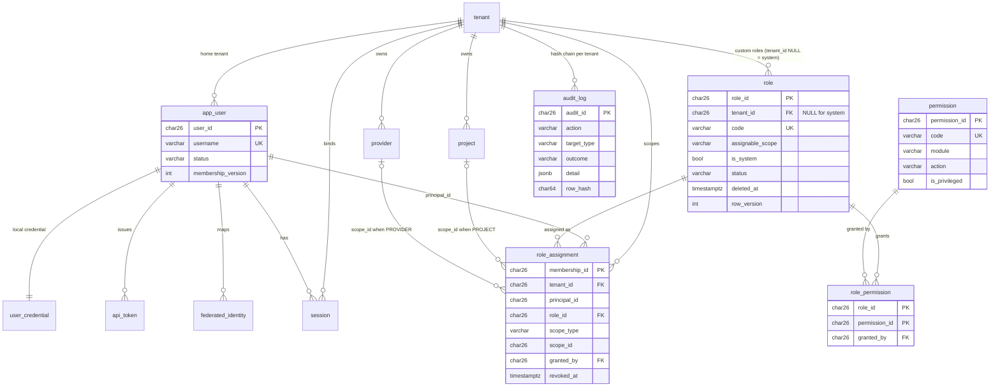

# QRP — Role-Based Access Control: Implementation Plan

**Project:** Quantum Resource Portal (QRP), Govern workspace of QRE · **Phase:** RBAC-1 (audit and design) · **Date:** 05-Nov-2026
**Status:** Proposed. Nothing in this plan is implemented yet. Decisions marked **R-xx** are listed in §12 and in `docs/DECISIONS.md`. Defaults are applied only after confirmation.

**Sources, in order of precedence** (same rule as `00_REQUIREMENTS_AND_DESIGN.md`: where the master prompt and the LLD disagree, the LLD wins and the difference is recorded):

| Ref | Document | Sections used |
|---|---|---|
| SRS | QRE SRS v1.0.0 (file `QRE_SRS_v2.pdf`) | §2.3 user classes, §4.2 identity (REQ-005…009), §4.1.3 REQ-001…004, §5 REQ-N011…N016, REQ-D004, REQ-V003, **Appendix B role and permission matrices (normative)** |
| HLD | QRE HLD v1.1.0 | §7.3 multi-tenant isolation, §8.1 approval state machine |
| LLD | QRE LLD v1.1.0 (`Final_LLD_Reviewed.docx`) | §4.1 CORE (TenantContext, Authorizer), §4.3 SVC-02, §8.2 endpoint catalogue (authorisation column), §11.1–11.12, Appendix B DDL, Appendix C errors, Appendix F audit actions, §14.11 TC-IAM/TC-SHL/TC-AUD, §17 PD/CF/NF registers |
| Repo | `docs/00_REQUIREMENTS_AND_DESIGN.md`, `docs/DECISIONS.md` | Prior role mapping (§3), navigation map (§2), decisions D-01…D-16 |

---

## 1. Audit summary (what is in the repository today)

### 1.1 Backend (`backend/`)

Only Phase 1 of the repository's own plan is built: app factory, settings, ULIDs, problem+json errors, correlation ids, JSON logging, async DB, `/healthz`, `/readyz`, and one Alembic revision (`0001`: `btree_gist`, `qre_append_only()` trigger function, `tenant` table).

| Area | State |
|---|---|
| Authentication | **None.** `svc02_identity/` contains only `__init__.py`. No login, session, CSRF, password hashing or `/me`. |
| Authorization | **None.** No `TenantContext`, `Authorizer`, permission matrix or dependencies. `core/errors.py` already has `AUTH_REQUIRED`, `AUTH_FORBIDDEN`, `SOD_VIOLATION`, `TENANT_CONTEXT_INVALID`, `RESOURCE_NOT_FOUND` (LLD App. C) — reusable. |
| Audit | **None.** `svc17_audit/` is empty; the append-only trigger *function* exists, no `audit_log` table. |
| Domain modules | **None.** SVC-03…SVC-15 packages are empty placeholders. The only API routes are the two health probes. |
| Tests | 27 tests, all passing (unit + 3 DB integration). `ruff check` clean. |

### 1.2 Frontend (`frontend/`)

A large UI exists (`pages/workspace/screens.tsx` 2 555 lines, `continue.tsx` 4 206 lines, ~45 routes). It is **not wired to this repository's backend**:

* It calls ~60 endpoint paths (`/auth/captcha`, `/auth/login`, `/projects`, `/workload-submissions`, `/virtual-pools`, `/inventory/assets`, `/governance/summary`, `/alerts`, `/incidents`, `/users/{u}/role`, `/users/roles/catalog`, …). None exist here. Several do not match the LLD catalogue either (LLD: `/assets`, `/workloads`, `/admin/memberships`). The README says these are served by an "integrated TeleScope API on :8000" from the *Quantum_Monitoring* monorepo, which is not in this repository.
* `lib/session.ts` stores a bearer token and the **role** in `localStorage` (`qrp_token`, `qrp_user`, `qre_role`).
* `api/qre.ts` sends **`X-User-Role` and `X-User-Name` headers chosen by the browser** on every request, falls back to role `'Admin'` when nothing is stored, and exports `setRole()`.
* `RequireAuth` only checks that `localStorage` has a token. There is no route- or action-level permission check. The sidebar shows every module to everyone.
* `RegisterPage` lets anyone self-register **and pick their role** (Operator/Researcher).
* `LoginPage` prints demo credentials `admin / quantum2026`.
* `QrpQuickActionDock` decides admin actions with `role.toLowerCase().includes('admin')`.
* `UsersPage` (`/qrp/users`) assigns roles by free-text username with `PATCH /users/{username}/role` — one role per user, no scope, `window.confirm` only.
* `e2e/auth.ts` fakes a session by writing `localStorage` (`token: 'e2e-dev'`).
* `api/client.ts` (Phase 1, LLD-aligned: same-origin cookie, problem+json → `ApiError`) is used only by the status page.
* Tests: Vitest 11/11 pass. `tsc -b` reports 2 errors in `e2e/*.spec.ts` (relative import without `.js` extension) — a typecheck problem in the test files that predates this work.

### 1.3 Classification of what exists

| Item | Verdict | Why |
|---|---|---|
| Client-chosen role in headers / localStorage | **Incorrect — critical** | Violates SRS §4.2.1 ("shall not treat a client-selected role as the source of authority"), REQ-006, LLD §4.3.2 step 3, §11.6, threat TH-02. Any backend that honours `X-User-Role` has broken access control. |
| Token in `localStorage` | **Incorrect** | LLD §11.6 forbids tokens in browser storage; LLD §11.3 specifies the HttpOnly `qre_sid` cookie + CSRF. `api/client.ts` already says "Nothing is ever written to localStorage". |
| Self-registration with role choice | **Incorrect — privilege escalation** | No SRS/LLD requirement for self-registration; role choice by the registrant contradicts REQ-006. |
| Single role per user (`PATCH /users/{u}/role`) | **Incomplete** | LLD `role_assignment` is many-per-user with tenant/project/provider scope. |
| `RequireAuth` | **Incomplete** | Authentication gate only; no authorization. |
| Hard-coded demo credentials on login page | **Incorrect for production** | Must be lab-only and not hard-coded in UI. |
| Two API clients (`api/client.ts`, `api/qre.ts`) | **Duplicated** | Keep `client.ts` (LLD-aligned), migrate `qre.ts` callers. |
| Error catalogue, correlation middleware, problem handlers | **Correct, reusable** | Used as-is for 401/403/404. |
| `qre_append_only()` trigger function | **Correct, reusable** | For `audit_log`. |

**Existing RBAC functionality that can be kept:** the error codes, the problem+json pipeline, the correlation id, the `tenant` table, the role mapping and navigation map in `00_REQUIREMENTS_AND_DESIGN.md` §2–§3, and the visual layer of `UsersPage`. Everything else in RBAC must be built.

---

## 2. What the reference documents fix, and what they leave open

**Fixed by SRS/LLD (implemented as specified):**

1. Default deny; the Authorizer evaluates *(role in scope) ∧ (resource in tenant) ∧ (state guard)* (LLD §11.2).
2. Roles and memberships live in authoritative records and are re-derived on **every** API call; never from client headers (REQ-006, LLD §4.3.2).
3. Role catalogue of nine codes with fixed scopes (LLD §4.3.1 role table).
4. Action matrix (LLD §11.2) implementing SRS Appendix B, which is normative and "shall not be reduced without an SRS amendment".
5. `role_assignment` with `scope_type`/`scope_id` (TENANT / PROJECT / PROVIDER) — this *is* the project-membership table; no separate `user_project_assignments` table is needed.
6. `app_user.membership_version` bumped on role change to force context reload (LLD §4.3.2 step 4, TC-IAM-002: revocation honoured within one request / ≤ 60 s).
7. Server-side session `qre_sid` (HttpOnly, Secure, SameSite=Lax), CSRF synchroniser token, idle 30 min / absolute 12 h, rotation on login and tenant switch (LLD §4.3.6, §11.3).
8. Cross-tenant ids return **404**, never 403 (LLD §11.4, TC-IAM-009).
9. Segregation of duties: the submitter cannot decide any stage of their own workload → `SOD_VIOLATION` (LLD §4.7, PD-25).
10. Append-only, hash-chained `audit_log`; actions `ROLE_GRANTED`, `ROLE_REVOKED`, `AUTHZ_DENIED`, `LOGIN_*`, `LOGOUT`, … (LLD App. F).
11. Server-derived navigation `GET /me/navigation` (REQ-002, FN-IAM-06, TC-SHL-002).

**Not covered by the documents (the master prompt asks for it; recorded as decisions):**

* Database-managed roles and permissions, custom roles, role CRUD, activate/deactivate (LLD has fixed codes and a `permissions.yaml` file) → **R-01**.
* Permission identifier style (`asset:read` vs `inventory.read`) → **R-02**.
* Super Administrator and Support Administrator roles (not in SRS/LLD) → **R-03**, **R-04**.
* User creation / deactivation endpoints (LLD only has `/admin/memberships`) → **R-05**.
* Self-registration → **R-06**.
* Which backend serves the existing frontend modules → **R-07** (blocking for Phase 7).

---

## 3. Roles

No role hierarchy: LLD §11.2 is a flat matrix and "admin" categories do not inherit other roles' rights. In particular **PLATFORM_ADMIN does not hold `approval:decide`** (LLD matrix shows "—"), which satisfies the master prompt rule "do not grant all permissions to every administrator". A user may hold several roles in several scopes (LLD `role_assignment` is many-per-principal); effective permissions are the union, evaluated per scope.

| Code (LLD) | Master-prompt name | Assignable scope | Authority | Explicitly cannot |
|---|---|---|---|---|
| `PLATFORM_ADMIN` | Platform Administrator | TENANT | Connectors, credentials, schedules; provider state transitions; policies; tenant membership admin; custom roles (R-01); user lifecycle (R-05); settings; audit read + verify | Decide approvals; act outside its tenant; remove the last PLATFORM_ADMIN (§9) |
| `OPERATOR` | (Support/Operations) | TENANT | Read QRP; manual dispatch reconciliation; reservations; tickets triage; alert ack/resolve (Q-TeleScope) | Approve; manage inventory, providers, roles |
| `RESEARCHER` | Researcher / Standard User | PROJECT | Create, submit, withdraw own project's workloads; reserve in project; read project data and the catalogue | List the approval queue (TC-SHL-002); approve; dispatch unless policy allows (PD-39); see other projects |
| `PROJECT_OWNER` | Project Owner / Project Administrator | PROJECT | Researcher rights + stage-1 approvals where assigned + project membership admin (project-scoped roles only) + dispatch + project audit read/export | Decide own workloads (SoD); grant tenant-scoped roles; act in other projects |
| `QUOTA_APPROVER` | Approver | TENANT | Stage-2 (quota/policy) approvals; authorise/re-authorise; quota ledger maintenance (D-07); entitlement read | Change inventory, providers, roles; decide own workloads |
| `PROVIDER_ADMIN` | Provider Administrator | PROVIDER | Create provider (DRAFT); submit onboarding/manifests for **own** provider; read own provider's backends/connectors | State transitions (PLATFORM_ADMIN only); other providers |
| `AUDITOR` | Auditor | TENANT | Read everything in QRP; audit read, export, chain verify | Any write |
| `RESOURCE_MANAGER` | Resource Manager | TENANT | Inventory create/update/retire/import; topology; procurement refs; entitlements; SLA targets | Approve; manage roles; provider state. **Pending NF-01 / CF-09** — kept as specified in LLD |
| `ASSISTANT` (service) | — | PROJECT | SVC-19 drafting identity; no QRP permissions | Submit, approve, test-pass (REQ-062). Seeded, not assignable to humans |

Not introduced: **Super Administrator** (cross-tenant authority is not defined by SRS/LLD; the installer bootstraps the first PLATFORM_ADMIN per tenant — LLD §4.3 precondition) and **Support Administrator** (ticket triage is covered by OPERATOR; can be created as a custom role under R-01). See R-03, R-04.

---

## 4. Permission catalogue and role-permission matrix

**Identifier format:** `resource:action` (or `resource:sub:action`) as in LLD §11.2 and the repo navigation map — R-02. The master-prompt action categories map as: `create`/`update`/`delete` → the resource's write actions; `approve`/`reject` → `approval:decide` (one action, outcome in the body, LLD API-APR-03); `assign` → `membership:admin`; `manage` → `*:manage`; `execute` → `workload:dispatch`; `export` → `*:export`; `view_audit` → `audit:read`.

**Legend:** ✓ = held at tenant scope · **P** = only within an assigned project · **V** = only within an assigned provider · **own** = only records the caller created · — = denied. Column order: PA = PLATFORM_ADMIN, OP = OPERATOR, RS = RESEARCHER, PO = PROJECT_OWNER, QA = QUOTA_APPROVER, PV = PROVIDER_ADMIN, AU = AUDITOR, RM = RESOURCE_MANAGER. "Basis" cites the LLD §8.2 authorisation column, LLD §11.2, or SRS App. B; *ext* = QRP extension (R-01/R-05); *R-xx* = default pending decision.

| Module | Permission | PA | OP | RS | PO | QA | PV | AU | RM | Basis |
|---|---|---|---|---|---|---|---|---|---|---|
| Dashboard | `governance:read` | ✓ | ✓ | P | P | ✓ | V | ✓ | ✓ | API-GOV-01 "QRP roles"; SRS App. B QRP column |
| Users | `user:read` | ✓ | — | — | P | — | — | ✓ | — | ext R-05 |
| | `user:create` | ✓ | — | — | — | — | — | — | — | ext R-05 |
| | `user:update` (profile fields, activate/deactivate) | ✓ | — | — | — | — | — | — | — | ext R-05 |
| Membership | `membership:read` | ✓ | — | — | P | — | — | ✓ | — | API-IAM-07 |
| | `membership:admin` (grant/revoke) | ✓ | — | — | P | — | — | — | — | LLD §11.2 ("project members" for PO), API-PRJ-02 |
| Roles | `role:read` | ✓ | — | — | — | — | — | ✓ | — | ext R-01 |
| | `role:create`, `role:update`, `role:delete` | ✓ | — | — | — | — | — | — | — | ext R-01 (custom roles only) |
| Permissions | `permission:read` | ✓ | — | — | — | — | — | ✓ | — | ext R-01 (catalogue is read-only for everyone) |
| Projects | `project:read` | ✓ | ✓ | P | P | ✓ | — | ✓ | — | API-PRJ-01 |
| | `project:create` | ✓ | — | — | — | — | — | — | — | R-11 |
| | `project:update` | ✓ | — | — | P | — | — | — | — | LLD §11.2 `project:write` |
| Inventory | `asset:read` | ✓ | ✓ | ✓ | ✓ | ✓ | V | ✓ | ✓ | API-INV-01 "readers"; R-08 |
| | `asset:create`, `asset:update`, `asset:retire`, `asset:import`, `topology:write` | ✓ | — | — | — | — | — | — | ✓ | API-INV-01…04; LLD `asset:write` |
| Resource pools | `pool:read`, `pool:manage` | R-09 | | | | | | | | Not in SRS/LLD (frontend-only module) |
| Providers | `provider:read` | ✓ | ✓ | ✓ | ✓ | ✓ | V | ✓ | ✓ | SRS App. B QRP "R" |
| | `provider:create` | ✓ | — | — | — | — | ✓ | — | — | API-PRV-01; R-10 |
| | `provider:manifest:write` (onboarding) | ✓ | — | — | — | — | V | — | — | API-PRV-02; LLD §11.2 |
| | `provider:state:transition` | ✓ | — | — | — | — | — | — | — | API-PRV-03; REQ-036 |
| Backends | `backend:read` | ✓ | ✓ | P | ✓ | ✓ | V | ✓ | ✓ | LLD §11.2 `telemetry:read / backends:read` |
| Connectors | `connector:read` | ✓ | ✓ | — | — | — | V | ✓ | — | SRS App. B (OP "R schedules", AU "R", PV provider scope) |
| | `connector:configure`, `connector:credential:rotate` | ✓ | — | — | — | — | — | — | — | API-CON-01…05 |
| Policies | `policy:read` | ✓ | ✓ | ✓ | ✓ | ✓ | — | ✓ | ✓ | SRS App. B QRP "R" |
| | `policy:publish` | ✓ | — | — | — | — | — | — | — | API-APR-05 |
| Quotas | `quota:read` | ✓ | ✓ | P | P | ✓ | — | ✓ | — | SRS App. B |
| | `quota:manage` (ledger) | ✓ | — | — | — | ✓ | — | — | — | D-07 |
| Workloads | `workload:read` | ✓ | ✓ | P | P | ✓ | — | ✓ | — | API-APR-02 (submitter, approvers, AUDITOR) |
| | `workload:create`, `workload:submit` | ✓ | — | P | P | — | — | — | — | API-WKL-01/03; LLD §11.2 |
| | `workload:withdraw` | ✓ | — | P own | P | — | — | — | — | API-WKL-03 "submitter"; HLD §8.1 "submitter or admin" |
| Approvals | `approval:read` (queue) | ✓ | — | — | P | ✓ | — | ✓ | — | API-APR-01/02; TC-SHL-002 (RS denied) |
| | `approval:decide` (stage-bound, SoD) | — | — | — | P | ✓ | — | — | — | LLD §11.2 (stage-1 PO, stage-2 QA); PD-25 |
| | `workload:authorize` | ✓ | — | — | — | ✓ | — | — | — | API-APR-04 |
| Reservations / Scheduling | `reservation:read` | ✓ | ✓ | P | P | ✓ | — | ✓ | — | API-SCH-01 "project members, operators" |
| | `reservation:create`, `reservation:cancel` | ✓ | ✓ | P | P | — | — | — | — | API-SCH-01; R-13 for confirm |
| Dispatch | `dispatch:read` | ✓ | ✓ | P | P | — | — | ✓ | — | API-EXE-02/05 |
| | `workload:dispatch` | ✓ | — | policy | P | — | — | — | — | API-EXE-01; LLD §11.2; PD-39 / D-09 |
| | `dispatch:reconcile` | ✓ | ✓ | — | — | — | — | — | — | API-EXE-03 |
| Metering | `usage:read` | ✓ | ✓ | P | P | ✓ | — | ✓ | ✓ | API-MTR-01 "QRP roles" |
| | `usage:adjust` | ✓ | — | — | — | — | — | — | — | App. F `USAGE_ADJUSTED`; R-14 |
| | `report:export` | ✓ | — | — | P | ✓ | — | ✓ | ✓ | API-RPT-01 "per report kind"; R-14 |
| SLA | `sla:read` | ✓ | ✓ | — | — | ✓ | V | ✓ | ✓ | API-MTR-02 "readers" |
| | `sla:target:write` | ✓ | — | — | — | — | — | — | ✓ | API-MTR-02 |
| Procurement (SVC-05, flagged) | `procurement:read` | ✓ | — | — | — | ✓ | — | ✓ | ✓ | API-PRC-01 |
| | `procurement:write` | ✓ | — | — | — | — | — | — | ✓ | LLD §11.2 |
| Entitlements (SVC-05, flagged) | `entitlement:read` | ✓ | — | — | P | ✓ | — | ✓ | ✓ | API-PRC-03 |
| | `entitlement:grant` | ✓ | — | — | — | ✓ | — | — | ✓ | API-PRC-03; R-15 |
| Support tickets | `ticket:read` | ✓ | ✓ | own | own | own | own | ✓ | own | API-SUP-01 "Authenticated" |
| | `ticket:create` | ✓ | ✓ | ✓ | ✓ | ✓ | ✓ | — | ✓ | API-SUP-01 |
| | `ticket:update`, `ticket:escalate` | ✓ | ✓ | — | — | — | — | — | — | R-04 |
| Incidents / Alerts | `alert:read`, `alert:ack`, `alert:resolve`, `incident:*` | ✓ | ✓ | — | — | — | — | (read) | — | LLD §11.2 (Q-TeleScope); QRP pages pending R-09 |
| Audit | `audit:read` | ✓ | — | — | P | — | — | ✓ | — | API-AUD-01; LLD §11.2 |
| | `audit:export` | ✓ | — | — | P | — | — | ✓ | — | SRS App. B "Audit export" column |
| | `audit:verify` | ✓ | — | — | — | — | — | ✓ | — | API-AUD-01 |
| Notifications | (own notifications) | authenticated | | | | | | | | D-05 |
| Settings | `settings:read`, `settings:write` | ✓ | — | — | — | — | — | — (read) | — | Repo nav map |

Implicit for every authenticated principal (not stored as permissions): `GET /me`, `GET /me/navigation`, `GET /me/permissions`, own notifications, own tickets, logout.

**Totals:** about 70 permission codes across 24 modules. The seed file is the single source; `permissions.yaml` from LLD §13.3 becomes the seed input (R-01), so the LLD artefact still exists and stays reviewable in code review.

---

## 5. Authorization model

### 5.1 Effective permissions

```
effective(principal, tenant) = ⋃ { (perm, scope) |
        a ∈ role_assignment, a.principal_id = principal, a.tenant_id = tenant, a.revoked_at IS NULL,
        r = role(a.role_id), r.status = 'ACTIVE', r.deleted_at IS NULL,
        p ∈ role_permission(r), p.status = 'ACTIVE',
        scope = (a.scope_type, a.scope_id) }
```

Only if `app_user.status = 'ACTIVE'`, `tenant.status = 'ACTIVE'`, and the session is valid.

### 5.2 Decision: `Authorizer.require(ctx, permission, resource=None)`

1. No valid session/token → **401** `AUTH_REQUIRED` / `AUTH_SESSION_EXPIRED`.
2. `permission` not in the catalogue → programming error (500, caught by tests).
3. `resource.tenant_id ≠ ctx.tenant_id` → **404** `RESOURCE_NOT_FOUND` (no existence leak).
4. A grant `(permission, scope)` covers the resource: TENANT covers every resource in the tenant; PROJECT *p* covers resources with `project_id = p`; PROVIDER *v* covers the provider and its backends, connectors, manifests and assets.
5. Not covered: if the caller holds **no read** on the resource either → **404** (cross-project ids behave like cross-tenant ids, SRS REQ-009 "403 or 404 per policy", R-16); otherwise → **403** `AUTH_FORBIDDEN` and audit `AUTHZ_DENIED`.
6. Domain state guards and SoD run in the service after step 4 (e.g. `SOD_VIOLATION`, `INVALID_STATE_TRANSITION`).

`Authorizer.can()` is the non-raising variant (navigation, `/me/permissions`). List endpoints never filter in Python: the repository receives `ctx.scope_filter(permission)` → `WHERE tenant_id = :t [AND project_id = ANY(:projects)]`.

### 5.3 FastAPI dependencies (adapted to the existing `qre/` conventions)

```python
ctx: TenantContext = Depends(get_ctx)                                   # authenticated, 401 otherwise
_ = Depends(require_permission("asset:create"))                          # tenant-level check
_ = Depends(require_any_permission("approval:read", "workload:read"))
_ = Depends(require_all_permissions("role:update", "permission:read"))
_ = Depends(require_role("PLATFORM_ADMIN"))                              # only where the LLD names a role, e.g. bootstrap
authz.require(ctx, "approval:decide", ResourceRef.workload(w))           # resource-scoped, inside the service
```

Every router is registered through a helper that fails start-up if a non-public route has no authorization dependency (deny by default, checked by a unit test that walks `app.routes`).

### 5.4 Stale permissions

Authorization context is rebuilt **per request** from the database (one indexed query; no cross-request cache in the lab profile). The LLD allows a 60 s cache (`{tenant}:authz:{principal}`); if enabled later, its key includes `app_user.membership_version` and a tenant `authz_version` that is bumped whenever a role's permission set or status changes, so a change is honoured on the next request (TC-IAM-002 asks ≤ 60 s; this gives 0 s).

---

## 6. Database design

### 6.1 Tables

LLD tables are created **as in Appendix B**, with the additive changes marked ➕ (QRP extension, change request to LLD, same treatment as D-04/D-05). One Alembic revision per step; `0001` is never edited.

| Table | Origin | Purpose |
|---|---|---|
| `tenant` | LLD (exists, rev 0001) | Isolation boundary. ➕ `authz_version INTEGER NOT NULL DEFAULT 1` |
| `app_user` | LLD | Human principals; `status`, `membership_version`. ➕ `created_by`, `updated_by`, `deactivated_at` |
| `user_credential` | LLD | Argon2id hash; failed count, `locked_until`. Never returned by any API (REQ-D004) |
| `login_attempt` | LLD | Lockout analytics (REQ-N011) |
| `session` | LLD | `sid_hash`, `csrf_hash`, `last_seen_at`, `revoked_at`. ➕ `membership_version` (listed in LLD §4.3.1 Table but missing from App. B DDL) |
| `service_identity`, `api_token`, `federated_identity` | LLD | Created now for schema completeness; endpoints later (D-13) |
| `project` | LLD | Needed as a scope target for PROJECT assignments |
| `provider` | LLD | Needed as a scope target for PROVIDER assignments (Phase 4 of repo plan; created early, minimal columns as in App. B) |
| ➕ `role` | R-01 | Role catalogue: 9 system roles (global, `tenant_id NULL`, `is_system = true`) + tenant custom roles |
| ➕ `permission` | R-01 | Permission catalogue (seeded from `permissions.yaml`; read-only via API) |
| ➕ `role_permission` | R-01 | Role ↔ permission |
| `role_assignment` | LLD | User ↔ role in scope (this is the project/provider membership). ➕ `role_id` FK, `revoked_by`, `revoke_reason` |
| `audit_log` | LLD | Append-only, hash-chained, partitioned by month; doubles as authorization audit and assignment history (no separate `authorization_audit_logs`, master prompt §13 "avoid a duplicate audit architecture") |

### 6.2 New and changed columns (DDL sketch)

```sql
CREATE TABLE role (
  role_id        CHAR(26)     NOT NULL,
  tenant_id      CHAR(26),                         -- NULL = system role (global)
  code           VARCHAR(32)  NOT NULL,            -- ^[A-Z][A-Z0-9_]{2,31}$
  name           VARCHAR(100) NOT NULL,
  description    VARCHAR(500) NOT NULL DEFAULT '',
  assignable_scope VARCHAR(16) NOT NULL,           -- TENANT | PROJECT | PROVIDER
  is_system      BOOLEAN      NOT NULL DEFAULT false,
  status         VARCHAR(16)  NOT NULL DEFAULT 'ACTIVE',   -- ACTIVE | INACTIVE
  deleted_at     TIMESTAMPTZ,                       -- soft delete, custom roles only
  row_version    INTEGER      NOT NULL DEFAULT 1,   -- If-Match optimistic concurrency (LLD §8.1)
  created_at     TIMESTAMPTZ  NOT NULL DEFAULT now(),
  created_by     CHAR(26),
  updated_at     TIMESTAMPTZ  NOT NULL DEFAULT now(),
  updated_by     CHAR(26),
  CONSTRAINT pk_role PRIMARY KEY (role_id),
  CONSTRAINT fk_role_1 FOREIGN KEY (tenant_id) REFERENCES tenant(tenant_id),
  CONSTRAINT ck_role_1 CHECK (status IN ('ACTIVE','INACTIVE')),
  CONSTRAINT ck_role_2 CHECK (assignable_scope IN ('TENANT','PROJECT','PROVIDER')),
  CONSTRAINT ck_role_3 CHECK (is_system = (tenant_id IS NULL)),
  CONSTRAINT ck_role_4 CHECK (NOT is_system OR deleted_at IS NULL)
);
-- one live code per tenant, and custom codes may never shadow a system code
CREATE UNIQUE INDEX ux_role_code ON role (COALESCE(tenant_id, '*'), code) WHERE deleted_at IS NULL;
CREATE UNIQUE INDEX ux_role_system_code ON role (code) WHERE is_system;
-- + trigger trg_role_no_shadow: reject custom code equal to any system code

CREATE TABLE permission (
  permission_id  CHAR(26)     NOT NULL,
  code           VARCHAR(64)  NOT NULL,            -- e.g. asset:create
  module         VARCHAR(32)  NOT NULL,            -- e.g. inventory
  action         VARCHAR(24)  NOT NULL,            -- create|read|update|delete|approve|assign|manage|execute|export|view_audit
  name           VARCHAR(100) NOT NULL,
  description    VARCHAR(500) NOT NULL,
  is_privileged  BOOLEAN      NOT NULL DEFAULT false,  -- membership:admin, role:*, connector:*, provider:state:*, audit:export …
  status         VARCHAR(16)  NOT NULL DEFAULT 'ACTIVE',
  created_at     TIMESTAMPTZ  NOT NULL DEFAULT now(),
  CONSTRAINT pk_permission PRIMARY KEY (permission_id),
  CONSTRAINT uq_permission_1 UNIQUE (code)                              -- requirement 1
);

CREATE TABLE role_permission (
  role_id        CHAR(26)    NOT NULL,
  permission_id  CHAR(26)    NOT NULL,
  granted_at     TIMESTAMPTZ NOT NULL DEFAULT now(),
  granted_by     CHAR(26),
  CONSTRAINT pk_role_permission PRIMARY KEY (role_id, permission_id),   -- requirement 2
  CONSTRAINT fk_role_permission_1 FOREIGN KEY (role_id) REFERENCES role(role_id) ON DELETE RESTRICT,
  CONSTRAINT fk_role_permission_2 FOREIGN KEY (permission_id) REFERENCES permission(permission_id) ON DELETE RESTRICT
);
CREATE INDEX ix_role_permission_1 ON role_permission (permission_id);
-- trigger trg_role_permission_system_locked: INSERT/DELETE on rows of a system role only from the migration role

-- role_assignment: LLD columns unchanged, plus:
ALTER TABLE role_assignment ADD COLUMN role_id CHAR(26) NOT NULL REFERENCES role(role_id) ON DELETE RESTRICT;
ALTER TABLE role_assignment ADD COLUMN revoked_by CHAR(26), ADD COLUMN revoke_reason VARCHAR(500);
-- LLD uq_role_assignment_1 is replaced (R-17) because (a) it would block re-granting a revoked role and
-- (b) NULL scope_id (tenant scope) is never equal to NULL, so duplicates would slip through:
CREATE UNIQUE INDEX ux_role_assignment_active
  ON role_assignment (tenant_id, principal_id, role_id, scope_type, COALESCE(scope_id, '*'))
  WHERE revoked_at IS NULL;                                              -- requirement 3
ALTER TABLE role_assignment ADD CONSTRAINT ck_role_assignment_1
  CHECK ((scope_type = 'TENANT') = (scope_id IS NULL));
```

Foreign keys for actor columns (`created_by`, `granted_by`, `revoked_by`) reference `app_user(user_id)` with `ON DELETE RESTRICT`; users are never hard-deleted (status `DISABLED`). `role_assignment.scope_id` cannot use one FK for two target tables; a trigger checks it against `project` or `provider` in the same tenant.

Indexes: LLD `ix_role_assignment_1 (principal_id, tenant_id)`; ➕ `ix_role_assignment_2 (role_id) WHERE revoked_at IS NULL` (users-per-role counts); `ix_audit_log_3 (tenant_id, target_type, target_id, occurred_at DESC)` (assignment history).

### 6.3 Integrity rules (enforced in the database where possible, otherwise in one service transaction)

| Rule | Mechanism |
|---|---|
| No duplicate permission / role-permission / active user-role | `uq_permission_1`, `pk_role_permission`, `ux_role_assignment_active` |
| System roles cannot be renamed, deactivated, deleted, or have permissions changed through the API | `ck_role_3/4`, trigger on `role_permission`, service check → 409 `INVALID_STATE_TRANSITION` |
| Role with active assignments cannot be deleted | Service check under lock → 409; soft delete only (`deleted_at`), FK `RESTRICT` blocks hard delete |
| Role scope matches assignment scope | Service check + trigger (`role.assignable_scope = role_assignment.scope_type`) |
| Last PLATFORM_ADMIN cannot be revoked, deactivated or disabled | Service check inside `pg_advisory_xact_lock(hashtext('authz:' \|\| tenant_id))`; DB constraint trigger as backstop |
| Audit history never deleted | `trg_append_only_audit` (LLD); app DB role has no `UPDATE/DELETE` on `audit_log` |
| Every change traceable | `created_by/updated_by/granted_by/revoked_by` + one audit row per change in the same transaction |

### 6.4 ER diagram

Rendered copy: `docs/rbac-er-diagram.png`.



### 6.5 Seed data

* `backend/permissions.yaml` — permission catalogue and the system-role matrix (§4). Loaded by an **idempotent** data migration (`INSERT … ON CONFLICT (code) DO NOTHING`; changes to system roles ship as new migrations, never edits).
* `python -m qre bootstrap --tenant-code CDAC --admin-username …` — installer step (LLD §4.3 precondition): creates the tenant and first PLATFORM_ADMIN, reads the password from a prompt or file, refuses if the tenant already has an admin.
* `seeds/seed_demo.py` (D-16) — DEMO tenant with one user per role, labelled DEMO DATA, refuses when `QRE_ENV=production`. No passwords in source; generated and printed once, or read from `backend/.env` in lab.

---

## 7. Backend implementation plan

### 7.1 Package layout (LLD vertical slices, existing convention)

```
backend/
  permissions.yaml                         NEW  catalogue + system-role matrix (seed source)
  qre/core/
    context.py                             NEW  TenantContext (frozen), ResourceRef, Grant
    authz.py                               NEW  PermissionCatalogue, Authorizer.require/can/scope_filter
    deps.py                                NEW  get_ctx, require_permission/any/all, require_role
    security.py                            NEW  Argon2id hasher, sid/csrf generation, constant-time compare
    pagination.py                          NEW  page/page_size (PD-07), Page[T] envelope
    uow.py                                 NEW  UnitOfWork (one transaction per command, audit inside)
    config.py                              EDIT session cookie name/secure flag, lockout values (PD-12), captcha flag
    db.py                                  EDIT BaseRepository with mandatory tenant predicate
  qre/gateway/
    app.py                                 EDIT include routers; route-guard check at start-up
    middleware/csrf.py                     NEW  synchroniser-token check on POST/PUT/PATCH/DELETE
  qre/services/svc02_identity/
    models.py                              NEW  AppUser, UserCredential, Session, LoginAttempt, Role, Permission,
                                                RolePermission, RoleAssignment, Project(min), Provider(min)
    repository.py                          NEW  UserRepo, RoleRepo, PermissionRepo, AssignmentRepo, SessionRepo
    service.py                             NEW  AuthService (login/logout/context), RoleService, AssignmentService,
                                                UserService, NavigationBuilder
    policies.py                            NEW  anti-escalation, last-admin, scope rules (pure functions, unit-tested)
    schemas.py                             NEW  Pydantic v2 DTOs, extra='forbid', response allow-lists
    api.py                                 NEW  routers (§7.2)
  qre/services/svc17_audit/
    models.py  service.py  api.py          NEW  AuditLog, write_audit (hash chain, D-15 advisory lock), search, verify
  qre/__main__.py                          EDIT add `bootstrap` command
  migrations/versions/
    20261106_0002_identity.py              NEW  app_user, user_credential, session, login_attempt, service_identity,
                                                api_token, federated_identity, project, provider (min)
    20261106_0003_rbac.py                  NEW  role, permission, role_permission, role_assignment + triggers
    20261106_0004_audit.py                 NEW  audit_log (partitioned) + trg_append_only_audit + grants
    20261106_0005_rbac_seed.py             NEW  load permissions.yaml (idempotent)
  tests/
    unit/test_authz.py  unit/test_rbac_policies.py  unit/test_route_guards.py
    integration/test_auth.py  test_roles_api.py  test_assignments_api.py  test_me.py  test_audit.py
    security/test_escalation.py  test_idor.py  test_tenant_isolation.py  test_last_admin.py  test_csrf.py
```

`requirements.txt` gains **one** dependency: `argon2-cffi` (already named in the repo plan §7.1 for Phase 3). PyYAML is needed to read `permissions.yaml` — or the file is JSON to avoid a dependency (R-18).

### 7.2 API (under `/api/v1`)

LLD endpoints keep their LLD paths; ➕ are extensions.

| Method & path | Permission | Notes |
|---|---|---|
| `POST /auth/login` | public, rate-limited | API-IAM-01; sets `qre_sid`, returns `csrf_token`; generic 401; lockout PD-12; audit `LOGIN_*` |
| `POST /auth/logout` | authenticated | API-IAM-05; revokes session; audit `LOGOUT` |
| `GET /auth/captcha` | public | ➕ only when `QRE_CAPTCHA_ENABLED=true` (SRS §4.2.1 "optional CAPTCHA") |
| `GET /me` | authenticated | API-IAM-06; principal, tenant, roles with scopes, `csrf_token`, `permissions_version` |
| `GET /me/navigation` | authenticated | API-IAM-06; server-derived nav (REQ-002) |
| `GET /me/permissions` | authenticated | ➕ effective permissions grouped by module and scope |
| `POST /authz/check` | authenticated | ➕ `{permission, resource_type, resource_id}` → `{allowed, reason}` for the *caller only* (no probing of other users) |
| `GET /admin/roles` | `role:read` | ➕ search, status filter, pagination; includes `user_count`, `permission_count` |
| `POST /admin/roles` | `role:create` | ➕ custom role; body: code, name, description, assignable_scope, permission_codes |
| `GET /admin/roles/{id}` | `role:read` | ➕ detail with permissions |
| `PATCH /admin/roles/{id}` | `role:update` | ➕ `If-Match: row_version`; name/description only |
| `POST /admin/roles/{id}/activate`, `/deactivate` | `role:update` | ➕ deactivate bumps `tenant.authz_version` |
| `PUT /admin/roles/{id}/permissions` | `role:update` | ➕ replace set atomically; diff written to audit |
| `POST /admin/roles/{id}/permissions`, `DELETE /admin/roles/{id}/permissions/{code}` | `role:update` | ➕ add / remove one |
| `DELETE /admin/roles/{id}` | `role:delete` | ➕ soft delete; 409 if assigned or system |
| `GET /admin/roles/{id}/users` | `role:read` + `membership:read` | ➕ users holding the role |
| `GET /admin/permissions` | `permission:read` | ➕ `?group_by=module`; includes associated roles |
| `GET /admin/permissions/{code}` | `permission:read` | ➕ |
| `GET /admin/users`, `GET /admin/users/{id}` | `user:read` | ➕ R-05 |
| `POST /admin/users`, `PATCH /admin/users/{id}`, `POST /admin/users/{id}/activate`, `/deactivate` | `user:create` / `user:update` | ➕ R-05; deactivate revokes all sessions |
| `GET /admin/memberships?principal_id=&role=&scope_type=&scope_id=` | `membership:read` | API-IAM-07 |
| `POST /admin/memberships` | `membership:admin` at the target scope | API-IAM-07; `{principal_id, role_code, scope_type, scope_id}` |
| `DELETE /admin/memberships/{membership_id}` | `membership:admin` at the assignment's scope | API-IAM-07; soft revoke with reason |
| `GET /admin/users/{id}/effective-permissions` | `user:read` + `membership:read` | ➕ |
| `GET /admin/users/{id}/assignment-history` | `membership:read` + `audit:read` | ➕ from `audit_log` |
| `GET /audit`, `GET /audit/verify` | `audit:read`, `audit:verify` | API-AUD-01 |

Responses: success = resource JSON or `{items, page, page_size, total}`; errors = existing problem+json. 401 vs 403 vs 404 as in §5.2. 409 for state conflicts, 412/409 `REVISION_CONFLICT` on stale `If-Match`.

### 7.3 Authentication integration

Built to LLD §4.3 because no authentication exists in this backend (nothing to replace — master prompt §8 "do not implement a second authentication system" is respected; the frontend's current login targets a backend outside this repository, see R-07).

* Local login, Argon2id (m = 64 MiB, t = 3, p = 1), dummy hash for unknown users, lockout 5 failures / 15 min → 15 min (PD-12, configurable).
* Session row keyed by SHA-256(sid); idle 30 min, absolute 12 h; `last_seen_at` refreshed at most once per minute; rotation on login and tenant switch; logout and user deactivation set `revoked_at`.
* CSRF: token returned in the login response and `GET /me`, held in memory by the SPA, sent as `X-CSRF-Token`; compared to `csrf_hash` in constant time.
* OIDC/SAML/TOTP/API tokens: tables created now; endpoints deferred per D-13. IdP group mapping must never grant PLATFORM_ADMIN unless explicitly mapped (LLD §4.3.2 step 2) — enforced when federation lands.
* Inactive user (`status ≠ ACTIVE`): login returns the generic 401; existing sessions are rejected on the next request (`AUTH_SESSION_EXPIRED`).

---

## 8. Frontend implementation plan

### 8.1 Replace the trust model

| Change | Files |
|---|---|
| Remove `localStorage` token/role, `X-User-Role`, `X-User-Name`, `setRole`, `currentRole`, `ROLES` | `lib/session.ts` (delete), `api/qre.ts` (reduce to a thin wrapper over `api/client.ts`, then retire) |
| Add CSRF header injection and 401 handling to the existing client | `api/client.ts`, `api/client.test.ts` |
| `AuthProvider` + `useAuth()`: loads `GET /me` before any protected render (LLD §11.3 "SPA calls /me before rendering protected data"); holds csrf in memory | `auth/AuthProvider.tsx` (new), `app/providers.tsx` |
| Login posts to `/auth/login`, no `setSession` | `pages/public/LoginPage.tsx`; demo credentials hint shown only when `GET /me`-less lab flag says so, never hard-coded |
| Registration per R-06 | `pages/public/RegisterPage.tsx` |

### 8.2 Reusable authorization utilities (`src/auth/`)

`usePermissions()` · `useHasPermission(code, scope?)` · `useHasAnyPermission(...)` · `useHasRole(code, scope?)` · `<PermissionGate permission=… fallback=…>` · `<ProtectedRoute permission=…>` (renders `AccessDeniedPage` in place for a direct URL, keeps the URL) · `routePermissions.ts` (one map route → permission, shared by router and sidebar, mirroring the server's module registry).

### 8.3 Screens (new pages under `src/pages/admin/`, existing primitives `Page`, `Card`, `Table`, `QueryBody`, `EmptyState`, `StatusBadge`, existing tokens: white/`#F7F9FC` surface, `#536DFE` primary, `#7957E8` violet, `#20B8D5` cyan)

| Route | Screen | Permission |
|---|---|---|
| `/qrp/admin/roles` | A. Role list (name, description, users, permissions, status, created, actions; search/filter/pagination) | `role:read` |
| `/qrp/admin/roles/new`, `/qrp/admin/roles/:roleId/edit` | B. Role editor (code, name, description, scope, permissions grouped by module with select-all/none per module, summary, validation; system roles read-only) | `role:create` / `role:update` |
| `/qrp/admin/roles/:roleId` | Role detail (permissions, users holding it, history) | `role:read` |
| `/qrp/admin/permissions` | C. Permission catalogue (code, name, module, description, roles) — read-only | `permission:read` |
| `/qrp/admin/users` | D. Users & role assignment (replaces `/qrp/users`, which redirects) — user info, roles with scope, status, assign/revoke dialogs, history | `user:read` / `membership:admin` |
| `/qrp/admin/users/:userId` | E. User permission view (details, roles, effective permissions by module, scopes, history) | `user:read` |
| `/403` and inline | F. Access denied (what was denied, who to ask, "Back to Overview") | — |
| `/qrp/profile` | G. Current user profile (name, email, roles, effective permissions, status, session expiry) | authenticated |

Every page has loading (skeleton), empty, error (with correlation id) and success (toast) states; destructive actions use a confirmation dialog that names the object (replacing `window.confirm`).

### 8.4 Application-wide gating

* Sidebar (`components/layout/chrome.tsx`) renders the `GET /me/navigation` list; items absent from it are not rendered.
* Router (`app/router.tsx`): every `/qrp/*` route wrapped in `ProtectedRoute` with its permission from `routePermissions.ts`.
* Page actions (create asset, decide approval, reconcile, publish policy, transition provider, export) wrapped in `PermissionGate`.
* `QrpQuickActionDock`: replace `role.includes('admin')` with permission checks.
* Seed-demo action (`api/seedDemo.ts`, Settings page) shown only with a lab flag *and* the permissions it needs; it calls endpoints that do not exist here (R-07).

---

## 9. Security risks and mitigations

| # | Risk | Mitigation | Test |
|---|---|---|---|
| S-1 | Client-chosen role (current `X-User-Role`) | Context only from session → DB; backend ignores those headers; frontend stops sending them | `test_escalation::test_role_header_ignored`, TC-IAM-010 |
| S-2 | Privilege escalation through role assignment | `membership:admin` required **at the target scope**; only PLATFORM_ADMIN may grant PLATFORM_ADMIN or any tenant-scoped role; PROJECT_OWNER may grant only PROJECT-scoped roles in their project; no self-grant/self-revoke; custom roles containing `is_privileged` permissions may be granted only by PLATFORM_ADMIN | `test_escalation.py` |
| S-3 | Unauthorized permission modification | Catalogue read-only via API; system roles immutable (DB trigger + service); only `role:update` on custom roles | `test_roles_api.py` |
| S-4 | IDOR / cross-project / cross-tenant | Tenant predicate in `BaseRepository`; resource-scoped `require`; 404 for out-of-scope ids; `tenant_id` never accepted from clients | TC-IAM-009, `test_idor.py` |
| S-5 | Inactive user / disabled role | Checked per request; deactivation revokes sessions; inactive roles drop out of `effective()` | `test_auth.py`, `test_roles_api.py` |
| S-6 | Role deletion while assigned | 409; FK RESTRICT; soft delete | `test_roles_api.py` |
| S-7 | Last-administrator lockout | Advisory lock + count of active PLATFORM_ADMIN on ACTIVE users; applies to revoke, user deactivate | `test_last_admin.py` incl. two concurrent revokes |
| S-8 | Self-approval | `SOD_VIOLATION` when decider = submitter (PD-25); enforced when SVC-06 lands, unit-tested in `policies.py` now | `test_rbac_policies.py` |
| S-9 | Stale permissions | Per-request derivation; `membership_version`, `authz_version` | TC-IAM-002 |
| S-10 | Mass assignment | `extra='forbid'`; separate create/update DTOs; server sets `tenant_id`, `is_system`, `created_by`, `row_version` | `test_roles_api.py::test_unknown_fields_rejected` |
| S-11 | Client-side bypass | Every route has a backend check; start-up guard fails on unguarded routes | `test_route_guards.py`; Playwright direct API calls |
| S-12 | Audit tampering | Append-only trigger; hash chain; no UPDATE/DELETE grant; `audit:verify` | TC-AUD-001 |
| S-13 | Secrets in logs/responses | Existing `mask()`; DTO allow-lists; never log sid/csrf/password | TC-AUD-002 |
| S-14 | CSRF on admin mutations | Synchroniser token; SameSite=Lax | `test_csrf.py` |
| S-15 | Brute force / enumeration | Rate limit, lockout, generic errors, dummy hash | TC-IAM-003/004 |
| S-16 | Concurrent role edits | `If-Match` row_version → `REVISION_CONFLICT`; one transaction per command | `test_roles_api.py` |
| S-17 | Denial-audit failure masking the denial | `AUTHZ_DENIED` written in its own short transaction so the 403 is never turned into a 500 | `test_audit.py` |

---

## 10. Testing strategy

* **Unit (pytest):** `Authorizer` decisions for every cell of the §4 matrix, generated from `permissions.yaml` (allowed *and* denied); scope coverage; `policies.py` (anti-escalation, last admin, SoD); route-guard walker.
* **Integration (pytest + real PostgreSQL `qre_test`):** login/logout/session expiry/lockout (TC-IAM-002…006); role CRUD; role-permission edits; assignments; effective permissions; multi-role union; inactive role/user; constraints (duplicate grant → 409, not 500); audit rows and hash chain (TC-AUD-001); masking (TC-AUD-002).
* **Security suite (`tests/security/`):** escalation, IDOR, cross-tenant (TC-IAM-009), admin endpoints as RESEARCHER (TC-IAM-010), header spoofing, CSRF, concurrent last-admin revoke.
* **Frontend (Vitest + Testing Library):** hooks, `PermissionGate`, `ProtectedRoute`, sidebar visibility per role, role editor (select-all per module, validation), assignment dialog, loading/error states, access-denied page; `client.ts` CSRF and 401 handling.
* **E2E (Playwright):** replace the `localStorage` fixture in `e2e/auth.ts` with a real login through the API (same test intent, real session). Scenario: admin creates role → assigns permissions → assigns to user → user logs in and sees only allowed modules → direct URL shows 403 page → direct API call returns 403 → revocation takes effect on next request → out-of-scope project id returns 404.
* Existing tests are kept. The current e2e specs assert pages populated by the external API; they keep running against that API until R-07 is settled and are not deleted or weakened.

---

## 11. Files to modify or create

**Modify (inspected):** `backend/requirements.txt`, `backend/.env.example`, `backend/qre/core/config.py`, `backend/qre/core/db.py`, `backend/qre/gateway/app.py`, `backend/qre/__main__.py`, `backend/tests/conftest.py`, `backend/seeds/README.md`; `frontend/src/api/client.ts`, `frontend/src/api/qre.ts`, `frontend/src/api/client.test.ts`, `frontend/src/app/router.tsx`, `frontend/src/app/providers.tsx`, `frontend/src/components/auth/RequireAuth.tsx`, `frontend/src/components/layout/chrome.tsx`, `frontend/src/components/shell/QrpQuickActionDock.tsx`, `frontend/src/pages/public/LoginPage.tsx`, `frontend/src/pages/public/RegisterPage.tsx`, `frontend/src/pages/workspace/continue.tsx` (`UsersPage`, `MemberForm`, `SettingsPage` session card), `frontend/src/pages/workspace/screens.tsx` (action gates), `frontend/e2e/auth.ts`; `docs/DECISIONS.md`, `docs/00_REQUIREMENTS_AND_DESIGN.md`, `README.md`.

**Delete:** `frontend/src/lib/session.ts` (after callers migrate).

**Create:** backend files in §7.1; frontend `src/auth/{AuthProvider.tsx,hooks.ts,PermissionGate.tsx,ProtectedRoute.tsx,routePermissions.ts,*.test.tsx}`, `src/api/rbac.ts` (typed calls), `src/pages/admin/{RolesPage,RoleEditorPage,RoleDetailPage,PermissionsPage,UsersAdminPage,UserPermissionsPage}.tsx`, `src/pages/system/{AccessDeniedPage,ProfilePage}.tsx`, `e2e/rbac.spec.ts`; docs `RBAC_REQUIREMENT_TRACEABILITY.md`, `RBAC_IMPLEMENTATION_STATUS.md`, later `RBAC_PERMISSION_MATRIX.md` (generated from `permissions.yaml`) and `RBAC_VSCODE_GUIDE.md`.

---

## 12. Decisions (proposed defaults; confirm before the phase that needs them)

| ID | Decision | Default | Needed before |
|---|---|---|---|
| R-01 | Roles/permissions in DB with custom roles (master prompt) vs LLD fixed codes + `permissions.yaml` | **Hybrid:** DB tables `role`/`permission`/`role_permission`; the 9 LLD roles seeded as immutable system roles (their permissions change only via reviewed migration, so SRS App. B is never reduced at runtime); PLATFORM_ADMIN may create tenant custom roles from the catalogue; recorded as LLD change request | RBAC-3 |
| R-02 | Permission identifier style | **LLD `resource:action`** (e.g. `asset:create`), not `inventory.create` | RBAC-2 |
| R-03 | Super Administrator | **Not introduced**; installer `bootstrap` command per tenant | RBAC-3 |
| R-04 | Support Administrator | **Not introduced**; ticket triage by OPERATOR; can be a custom role | RBAC-2 |
| R-05 | User create/deactivate endpoints (not in LLD) | **Add `/admin/users` (PLATFORM_ADMIN)**, flagged extension | RBAC-5 |
| R-06 | Self-registration | **Keep page, remove role choice; creates a `PENDING` user with no roles that a PLATFORM_ADMIN activates; disabled when `QRE_ENV=production` unless `QRE_SELF_REGISTRATION=true`** | RBAC-6 |
| R-07 | Which backend serves the existing module pages (frontend calls ~60 paths not in this repo) | See status document §4 — **needs your answer** | RBAC-7 |
| R-08 | Researcher read of the asset catalogue | Tenant-wide read of the catalogue (needed to request resources); project-only for workloads, usage, reservations | RBAC-2 |
| R-09 | Pools, alerts, incidents pages (not QRP SVCs in LLD) | Permissions defined, enforcement where their backend lives (R-07) | RBAC-7 |
| R-10 | PROVIDER_ADMIN creating a provider it is not yet scoped to | Creator is auto-assigned PROVIDER_ADMIN for the new DRAFT provider, audited | RBAC-7 |
| R-11 | Who creates projects in QRP | PLATFORM_ADMIN (QTarka researcher-created projects out of QRP scope) | RBAC-7 |
| R-12 | D-02 escalation to PLATFORM_ADMIN vs LLD (PA cannot decide) | Escalation **notifies** PA, who reassigns the stage; PA does not decide | SVC-06 |
| R-13 | Who confirms reservations | PLATFORM_ADMIN and OPERATOR | SVC-07 |
| R-14 | Usage adjustment and report export | As in matrix | SVC-14 |
| R-15 | Entitlement grant | RESOURCE_MANAGER, QUOTA_APPROVER (API-PRC-03), PA | SVC-05 |
| R-16 | Cross-project id response | 404 when caller has no read on the resource; 403 when it can see but not act | RBAC-4 |
| R-17 | LLD `uq_role_assignment_1` blocks re-grant and lets NULL-scope duplicates through | Partial unique index on active rows with `COALESCE(scope_id,'*')`; LLD change request | RBAC-3 |
| R-18 | `permissions.yaml` needs PyYAML (new dependency) | Keep YAML (LLD names it) and add `PyYAML`; alternative JSON | RBAC-3 |

---

## 13. Ordered roadmap

| Phase | Content | Exit check |
|---|---|---|
| **RBAC-1** Audit & design | This plan, traceability, status; decisions logged | Decisions confirmed |
| **RBAC-2** Matrix | `permissions.yaml` finalised; generated `RBAC_PERMISSION_MATRIX.md`; validation against SRS App. B (every SRS cell has a test row) | Matrix review signed off |
| **RBAC-3** Database | Migrations 0002–0005, models, triggers, seed, `bootstrap` command | `alembic upgrade head` / `downgrade base` round-trip; constraint tests green |
| **RBAC-4** Services | Auth (login/logout/session/CSRF), TenantContext, Authorizer, dependencies, audit writer, route-guard check | Unit + integration green; TC-IAM-002…006, TC-AUD-001/002 |
| **RBAC-5** APIs | Roles, permissions, users, memberships, effective permissions, `/me*`, `/authz/check`, `/audit` | API tests incl. 401/403/404/409; OpenAPI reviewed |
| **RBAC-6** Frontend admin | Auth provider, client CSRF, hooks/gates, screens A–G, login/register rework | Vitest green; manual walkthrough |
| **RBAC-7** App-wide | Router/sidebar/actions gated; module endpoints protected **where they exist** (R-07) | Per-module allow/deny tests |
| **RBAC-8** Security | Security suite; concurrency; tenant isolation | `tests/security` green |
| **RBAC-9** Validation | All suites incl. Playwright RBAC scenario | All green, existing tests still pass |
| **RBAC-10** Docs | Architecture, API, ER, matrix, traceability, VS Code guide, final status | Acceptance checklist (master prompt §18) |

### VS Code: commands used from RBAC-3 onward (repository root, integrated terminal)

```bash
make setup                         # venv + pip install -r requirements-dev.txt, npm ci, creates backend/.env
make migrate                       # alembic upgrade head (development DB "qre")
cd backend && .venv/bin/python -m qre bootstrap --tenant-code CDAC --admin-username admin   # once, prompts for password
make dev-api                       # FastAPI on http://127.0.0.1:8000  (docs: /api/v1/docs)
make dev-web                       # Vite on http://localhost:5176/qrp (vite.config.ts uses 5176)
make test                          # backend pytest (uses qre_test DB) + frontend vitest
make test-e2e                      # Playwright (backend must be running)
make lint                          # ruff + oxlint + tsc
```

Note: `README.md` says the web app runs on `:5173`, but `vite.config.ts` and `playwright.config.ts` use **5176**; the RBAC guide will use 5176 and README will be corrected.
