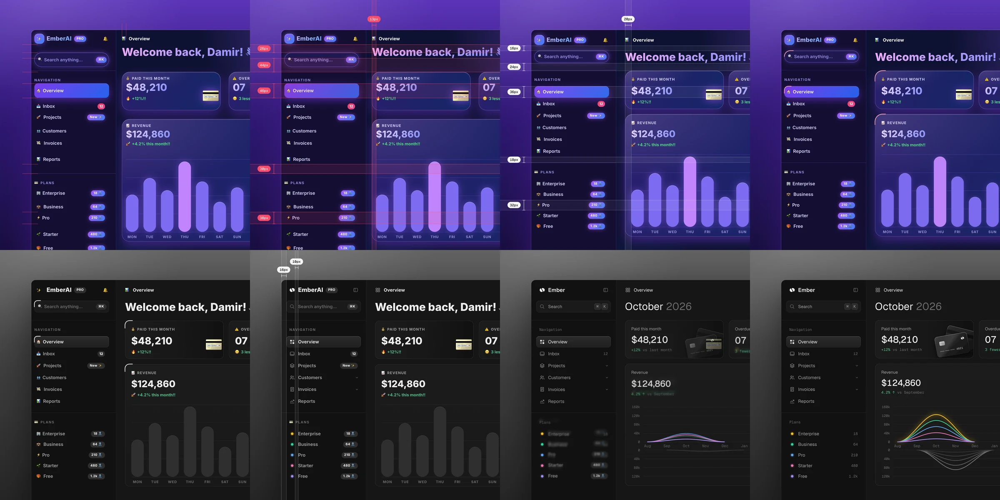

# unslop

Created by Damir Sokolovsky ([@heydamir](https://x.com/heydamir)), who started the [Unslopping series](https://x.com/heydamir/status/2115063463063998736) on X.



unslop is a skill for Claude Code, Codex and Google Antigravity that turns vibecoded, AI-looking UI into a designed interface with its own character. It finds the slop first, the purple gradients, glows, emoji labels, shouty copy and uneven spacing, then sets a direction from your product and fixes the screen pass by pass like a designer doing a redline review. It works in whatever your screen is built with, like Next.js, React, Vue, Svelte, Tailwind or plain HTML and CSS, on dashboards, apps and landing pages, and even on a live site when all you have is a link.

## Install

For Claude Code, install it as a plugin. Run this in a terminal to get it in every project:

```bash
claude plugin install unslop --marketplace heydamir/unslop
```

On an older Claude Code without `--marketplace`, the same in two steps:

```bash
claude plugin marketplace add heydamir/unslop
claude plugin install unslop@heydamir
```

To get it in a single project only, run the install from that project's root folder, the one you start Claude Code in, and add `--scope local`. To turn it on for everyone who works in the project, add `--scope project` instead and commit `.claude/settings.json`. Each teammate then runs this once in their own copy of the project:

```bash
claude plugin marketplace add heydamir/unslop
claude plugin install unslop@heydamir --scope project
```

Then start a new Claude Code session, or run `/reload-plugins` in one that is already open.

To update, run `claude plugin update unslop@heydamir`, or turn on auto-update for the heydamir marketplace under Marketplaces in `/plugin`.

If you copied unslop into `~/.claude/skills/` or a project's `.claude/skills/` before, delete that copy, or `/unslop` keeps running it instead of the plugin.

For Codex, ask it to install the skill straight from this repo.

```
$skill-installer install https://github.com/heydamir/unslop/tree/main/skills/unslop
```

Or copy it by hand into `~/.agents/skills/`, or into `.agents/skills/` inside a single project.

```bash
git clone https://github.com/heydamir/unslop
mkdir -p ~/.agents/skills && cp -r unslop/skills/unslop ~/.agents/skills/
```

For Google Antigravity, copy the skill into your skills folder.

```bash
git clone https://github.com/heydamir/unslop
mkdir -p ~/.gemini/config/skills && cp -r unslop/skills/unslop ~/.gemini/config/skills/
```

For a single project, copy it into `.agents/skills/` inside that project instead.

To snapshot a live site or create a story video, install Playwright and its Chromium browser from the project directory where you run the skill:

```bash
npm install -D playwright
npx playwright install chromium
```

Story videos also require ffmpeg installed and available on your PATH.

## Use

In Claude Code, type `/unslop` with what you want, or `/unslop:unslop` if another skill already has that name. In Codex, type `$unslop` the same way. Or just ask in your own words and the agent picks the skill up by itself.

```
/unslop this dashboard
/unslop the hero of https://example.com
/unslop my landing page and make the story video so I can post it
```

It audits the screen and proposes a direction before it edits anything, so you can steer it early. If the screen is already good, it tells you so and suggests a few small refinements instead of redesigning it.

## What it does

- **Audit.** Lists every sign of slop with where it lives.
- **Direction.** Character, world, the one or two moments that carry the color, and a signature detail, all taken from your product.
- **Passes.** Spacing, color, icons, copy, type, layout, details, visuals and motion, in that order.
- **Visuals.** Shows your product instead of a glossy blob. When a hero needs a scene or an object, it can generate one through an image service like fal, Replicate, OpenAI images or Higgsfield. If none is connected, it offers to connect one as an MCP server, and it shows the prompt and asks before every paid generation. Dashboards and apps rarely need one.
- **Story video.** A square video under 10 seconds of your screen unslopping itself, ready to post. It needs Playwright and ffmpeg.

Try it on the two vibecoded screens in [examples](examples).

## Hire the unslopper

Would rather have a designer do it? Damir unslops one key screen in 3 days, built in your stack, at [heydamir.design/unslop](https://heydamir.design/unslop).

## License

[CC BY 4.0](LICENSE). Use it, change it and share it, including commercially, as long as you credit Damir Sokolovsky ([@heydamir](https://x.com/heydamir)) and link back to this repository.
